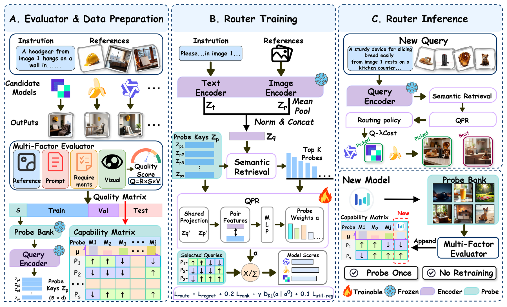
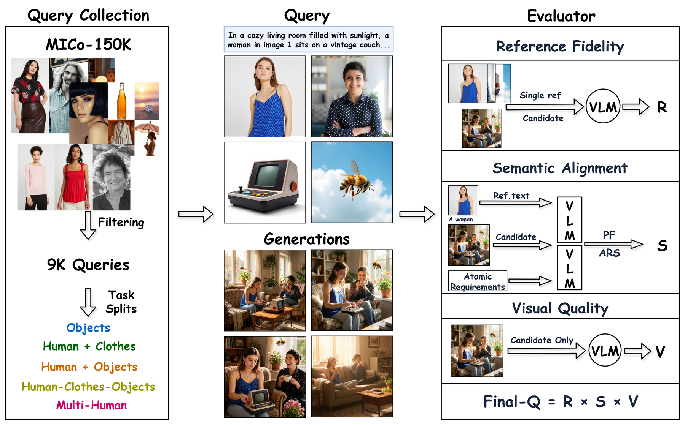

# MRG-Router

**Pre-Rendering Routing via Capability Probes for Multi-Reference Image Generation.**

This repository is the artifact release for **MRG-Router:
Pre-Rendering Routing via Capability Probes for Multi-Reference Image
Generation** and **MR-RouteBench**. It includes benchmark metadata, released
quality/cost matrices, router code, training/evaluation scripts, and lightweight
examples for inspecting the release.

<p align="center">
  
</p>

## Contents

- [Overview](#overview)
- [Method](#method)
- [Paper-to-Code Map](#paper-to-code-map)
- [Release Files](#release-files)
- [Installation](#installation)
- [Data Format](#data-format)
- [Common Commands](#common-commands)
- [Repository Layout](#repository-layout)
- [Release Notes](#release-notes)

## Overview

Multi-reference image generation often has no universally best generator:
different models specialize in different reference structures, visual entities,
and compositional constraints. MRG-Router addresses **pre-rendering routing**:
selecting a generator before any candidate image is rendered.

The release centers on two artifacts:

- **MR-RouteBench**, a dense routing benchmark with 9,000 multi-reference
  queries, 10 generator columns, decomposed quality scores, and compute traces.
- **MRG-Router**, a behavior-grounded router that represents generators by
  empirical probe-bank performance rather than static model identifiers.

The benchmark split is fixed:

| Split | Queries | Role |
|---|---:|---|
| Probe | 512 | Capability Probe Bank |
| Train | 6,888 | Router training |
| Validation | 600 | Model selection / operating point selection |
| Test | 1,000 | Held-out evaluation |

## Method

MRG-Router profiles every candidate generator on a compact Capability Probe
Bank. At inference time, a new multimodal query retrieves related probes and
uses Query-Conditioned Probe Reweighting (QPR) to estimate query-specific
generator capability. Cost is kept as a deployment attribute, enabling
quality-only or quality-cost routing without changing the capability profiles.

<p align="center">
  
</p>

The same representation also supports open-pool onboarding: a new generator is
evaluated once on the fixed probe bank, appended as a new capability column, and
can then be routed without retraining the query encoder or QPR module.

## Paper-to-Code Map

| Paper term | Implementation |
|---|---|
| Capability Probe Bank | `mrg_router.profiles` |
| Semantic Probe Retrieval | `mrg_router.retrieval` |
| Query-Conditioned Probe Reweighting (QPR) | `mrg_router.model.QPRMatcher` |
| Utility warm-up and routing optimization | `mrg_router.training` |
| Cost-aware selection | `mrg_router.policy` |
| Probe-based model onboarding | `scripts/onboard_generator.py` |
| Factorized evaluator | `mrg_router.evaluator` |

## Release Files

| Component | Files |
|---|---|
| Query metadata and splits | `data/mr_routebench/queries.jsonl.gz`, `data/mr_routebench/split.jsonl` |
| Quality matrix | `data/mr_routebench/outcomes.jsonl.gz` |
| Cost matrix | `data/mr_routebench/cost_matrix.jsonl.gz` |
| Generator list | `data/mr_routebench/generators.json` |
| CostBench-300 timing audit | `data/costbench300/records.csv.gz`, `summary.csv`, `protocol.json` |
| Router implementation | `src/mrg_router/` |
| Training / evaluation scripts | `scripts/build_profiles.py`, `scripts/train_router.py`, `scripts/evaluate_router.py` |
| Feature extraction and onboarding | `scripts/extract_features.py`, `scripts/onboard_generator.py` |
| Generation runners | `scripts/evaluation/*.py` |
| Configs and tests | `configs/`, `tests/` |

Full generated-image dumps, model weights, feature caches, raw API responses,
local logs, and machine-specific paths are not included in this code release.

## Installation

```bash
python -m pip install -e ".[test]"
```

Core dependencies are declared in `pyproject.toml`. Feature extraction requires
local text/image encoder checkpoints supplied by the user.

## Data Format

Each query record contains a text instruction and ordered references:

```json
{
  "query_id": "1H2C2O__000220",
  "task_structure": "1H2C2O",
  "reference_count": 5,
  "instruction": "...",
  "references": [
    {"reference_id": 1, "description": "...", "source_file": "input_00.jpg"}
  ]
}
```

The released manifest stores relative source filenames rather than local image
paths. For local feature extraction, add `image_path` to each reference after
obtaining the source images under their license.

Quality records contain the decomposed evaluator factors and final score:

```json
{
  "query_id": "...",
  "generator_id": "...",
  "reference_fidelity": 0.75,
  "semantic_alignment": 0.74,
  "perceptual_quality": 0.69,
  "quality": 0.38
}
```

See `DATA.md` for complete schemas and release validation details.

<p align="center">
  
</p>

## Common Commands

Build capability profiles from released outcomes:

```bash
python scripts/build_profiles.py \
  --outcomes data/mr_routebench/outcomes.jsonl.gz \
  --split data/mr_routebench/split.jsonl \
  --output artifacts/profiles.npz
```

Train a router from precomputed query features:

```bash
python scripts/train_router.py \
  --features /path/to/query_features.npz \
  --profiles artifacts/profiles.npz \
  --output artifacts/mrg_router.pt
```

Evaluate router predictions:

```bash
python scripts/evaluate_router.py \
  --predictions /path/to/predictions.jsonl \
  --outcomes data/mr_routebench/outcomes.jsonl.gz \
  --costs data/mr_routebench/cost_matrix.jsonl.gz
```

Extract local query features:

```bash
python scripts/extract_features.py \
  --queries /path/to/query_manifest_with_image_paths.jsonl \
  --bge /path/to/bge-m3 \
  --siglip /path/to/siglip2-base-patch16-224 \
  --output artifacts/query_features.npz
```

Prepare README figures from local source images:

```bash
python scripts/prepare_readme_assets.py \
  --demo-source /path/to/demo.png \
  --pipeline-source /path/to/evaluator_pipeline.png \
  --architecture-source /path/to/architecture.png
```

## Repository Layout

```text
assets/figures/              README figures
benchmark/                   small schema preview
configs/                     evaluator, router, and cost configs
data/mr_routebench/          query metadata, splits, outcomes, and costs
data/costbench300/           timing records and summaries
scripts/                     release utilities, training, evaluation, onboarding
scripts/evaluation/          generator-specific inference runners
src/mrg_router/              routing package
tests/                       lightweight unit tests
```

## Release Notes

This repository omits private filesystem paths, internal logs, raw service
responses, feature caches, full generated-image dumps, and model checkpoints.
Large generated-image archives should be hosted separately as a dataset release.

Project page, citation, and dataset links can be added as they become available.

## License

This code release is provided under the MIT License.
